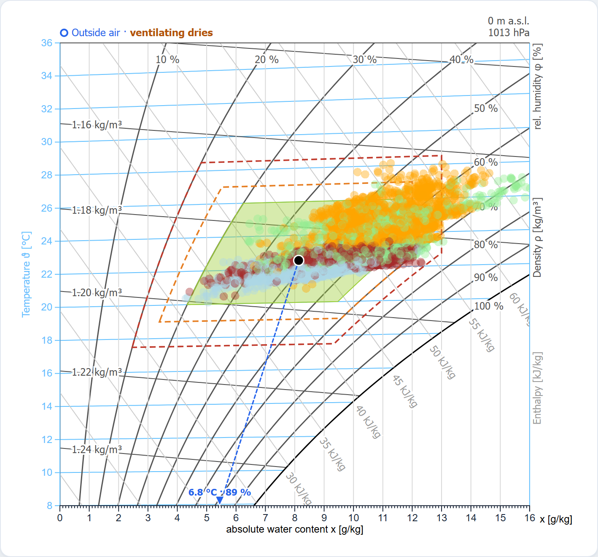

<p align="center">
  
</p>

<p align="center">
  <a href="https://hslu-ige-laes.github.io/d3-mollierhx/"></a>
  <a href="https://d3js.org/"></a>
  
  <a href="https://github.com/hslu-ige-laes/d3-mollierhx/discussions/categories/q-a"></a>
  <a href="LICENSE"></a>
</p>

<p align="center">Mollier h,x diagram (psychrometric chart) for the browser, built on D3.js: iso-lines, comfort zone, tolerance bands and season-coloured measurements.</p>

## Live demo
**[hslu-ige-laes.github.io/d3-mollierhx](https://hslu-ige-laes.github.io/d3-mollierhx/)** –
[interactive demo](https://hslu-ige-laes.github.io/d3-mollierhx/example/demo.html) with example data
(Zürich-Kloten, hourly), comfort zone, warning bands, outside air and ventilation line, and the
[MollierChart test page](https://hslu-ige-laes.github.io/d3-mollierhx/example/chart-test.html).

<hr>

## Overview
The Mollier h,x-diagram was proposed by Richard Mollier in 1923 and allows to describe changes of state of humid air. In the present case it is used to show comfort states regarding temperature and humidity.



- It is valid for a certain air pressure. The quantities temperature, humidity (absolute and relative), enthalpy and density can be read off directly.
- The basic scale for the h,x-diagram is a temperature scale, which is applied vertically as y-axis.
- The auxiliary lines drawn horizontally from left to right are the "isotherms", i.e. lines with constant air temperature. While the isotherm at 0 °C runs parallel to the horizontal axis, the isotherms at higher temperatures will increasingly rise to the right, due to the heat content of the increasing water content.
- The x-axis represents the water content x resp. the absolute humidity of the air.
- The comfort zone helps to indicate whether measured temperature/humidity values are within a comfortable range or not.
- Measured values get integrated as scatter plot and are coloured according to the season (winter, spring, summer, fall).

<hr>

## Usage
The D3 functions are structured in a way that the diagram can easily get integrated in own applications. Therefore csv file upload, comfort zone and data plotter are separated.

**Requirements:** [D3.js v7](https://d3js.org), e.g.
`<script src="https://cdn.jsdelivr.net/npm/d3@7.9.0/dist/d3.min.js"></script>`.
The files in `/src` are plain browser scripts (global functions, no build step) that also run in
strict mode, so they can be inlined, concatenated or wrapped as ES modules. Load order:
`mollierFunctions.js`, `coordinateGenerator.js`, `drawComfort.js`, then `mollierChart.js`.

### /example/mollierhx.js & demo.html
Exemplary straight forward implementation with a manual csv file uploader and a simple html-file.
> Note that the data plotter is integrated in mollierhx.js because it is use case dependant what should get displayed.

<hr>

## Options / API

### /src/mollierFunctions.js
Functions for the coordinate-transformations in the Mollier hx-diagram.
In order to understand the equations in the source refer to chapter 2.1 and 2.2 of <a href="http://berndglueck.de/dl/?dl=Stoffwerte+Stoffwerte.pdf" target="_blank">"Glück: Zustands- und Stoffwerte"</a>.

### /src/coordinateGenerator.js
The function "drawHXCoordinates()" draws the coordinate-lines of temperature,
density, enthalpy and relative humidity into an SVG-element.

```js
drawHXCoordinates(container, Width, Height, margin, domainX, domainY, p, mollier, opts)
```

`opts` (all optional):

| key | default | meaning |
| --- | --- | --- |
| `showTemperature`, `showDensity`, `showRelHumidity`, `showEnthalpy`, `showAbsHumidity` | `true` | curve families on/off (lines, labels and caption) |
| `xAxisTitle` | `""` | centred title below the x axis |
| `captions` | see below | caption texts; `""` hides a caption |

`captions` keys and English defaults (`HX_DEFAULT_CAPTIONS`):

| key | default | where |
| --- | --- | --- |
| `temperature` | `Temperature ϑ [°C]` | left axis, rotated |
| `rel_humidity` | `rel. humidity φ [%]` | right edge, top |
| `density` | `Density ρ [kg/m³]` | right edge, middle |
| `enthalpy` | `Enthalpy [kJ/kg]` | right edge, bottom |
| `x_axis` | `x [g/kg]` | right margin, beside the end of the x axis |
| `x_axis_title` | `""` (or `xAxisTitle`) | below the x axis |

The right-edge captions are laid out from the top of the axis down, one equal segment each, with a
common font size of 8–12 px that follows from text length and chart height, so they fit at 420 px
as well as at 700 px or more (very long translations are shortened with "…"). Every caption has the
CSS class `hx-caption` plus `hx-caption-temperature`, `hx-caption-rel-humidity`,
`hx-caption-density`, `hx-caption-enthalpy`, `hx-caption-x-axis` or `hx-caption-x-axis-title`.

```js
drawHXCoordinates(d3.select("#chart"), 600, 420, {top: 30, right: 60, bottom: 40, left: 50},
                  [0, 0.02], [-20, 50], 101325, createMollier(),
                  { captions: { temperature: "Temperatur ϑ [°C]", rel_humidity: "rel. Feuchte φ [%]",
                                density: "Dichte ρ [kg/m³]", enthalpy: "Enthalpie h [kJ/kg]" } });
```

### /src/drawComfort.js
drawComfort() creates the comfort-zone polygon (`createComfort()` returns its points).

The file also holds overlay helpers (plain globals). They draw into a `<g>` in plot coordinates
(translated to the top-left corner of the axes) and take a context
`ctx = { x, y, width, height, mollier, pressure }` (the d3 scales, the size of the axes in px, the
`createMollier()` suite and the pressure in Pa). A *state* is `{t, rh}` (rh in %), `{t, phi}`
(phi 0..1) or a diagram position `{x, y}`.

| function | purpose |
| --- | --- |
| `hxAddClipPath(svg, id, width, height)` | clip path for the data layers; returns `"url(#id)"` |
| `hxDrawStatePoint(layer, ctx, state, opts)` | point (`opts.color`, `opts.hollow`, `opts.r`, `opts.className`); outside the axes an arrow on the edge with its value |
| `hxDrawOutdoor(layer, ctx, outdoor, room, opts)` | outside air (hollow blue circle) + dashed ventilation line to the room point + note above the axes; returns `{outdoor, room, effect, note, marker}` |
| `hxVentilationEffect(room, outdoor, threshold)` | `"dries"` / `"humidifies"` / `"neutral"` / `null` (threshold 0.0003 kg/kg = 0.3 g/kg) |
| `hxVentilationNote(effect, texts)` | the sentence for an effect |
| `hxClampPoint(ctx, state)`, `hxDrawEdgeArrow(layer, ctx, pos, color, label)` | building blocks of the edge arrow |
| `hxState(state, mollier, p)`, `hxStateLabel(state, texts)` | normalise a state; edge label like `6.8 °C · 89 %` |

`hxDrawOutdoor` options: `color` (`#2563eb`), `ventilationLine` (`true`), `note` (`true`),
`notePosition` (`[0, -8]`), `threshold` (`0.0003`), `texts`. Draw it (and the room point) into an
**unclipped** layer, the data, comfort zone and bands into the clipped one.

**Outside air and ventilation:** when you air a room, the room air moves along the straight line to
the outside point (mixing). If the outside point lies to the **left** (less water per kg of air, by
more than 0.3 g/kg) airing dries the room, even when the outside air has 90 % relative humidity; to
the right it adds moisture (typical for a cool cellar in summer); otherwise there is no noticeable
change.

All texts are options with English defaults (`HX_DEFAULT_TEXTS`), no translations are built in:

| key | default |
| --- | --- |
| `outdoor` | `Outside air` |
| `room` | `Room` |
| `ventilation_dries` | `ventilating dries` |
| `ventilation_humidifies` | `ventilating adds moisture` |
| `ventilation_neutral` | `ventilating: no change` |
| `state_value` | `{t} °C · {rh} %` (edge-arrow label; also `{x}` in g/kg) |

CSS classes: `hx-outdoor`, `hx-outdoor-point`, `hx-ventilation-line`, `hx-ventilation-note`
(+ `hx-ventilation-dries|humidifies|neutral`), `hx-edge-arrow`, `hx-edge-label`, `hx-state`.

```js
const ctx = { x, y, width, height, mollier, pressure: 101325 };
const clipped = svg.append("g").attr("transform", `translate(${margin.left},${margin.top})`)
                   .attr("clip-path", hxAddClipPath(svg, "plot-clip", width, height));
const top = svg.append("g").attr("transform", `translate(${margin.left},${margin.top})`);
const res = hxDrawOutdoor(top, ctx, { t: 4, rh: 85 }, { t: 21, rh: 50 },
                          { texts: { outdoor: "Aussenluft", ventilation_dries: "Lüften trocknet" } });
hxDrawStatePoint(top, ctx, { t: 21, rh: 50 });
console.log(res.effect);   // "dries"
```

### /src/mollierChart.js
`MollierChart` is a stateful chart for fast, incremental updates: the coordinate grid is drawn once,
the overlays update in place (used by `pyedautils.plots.plot_mollier_hx_fast`).

```js
const chart = new MollierChart("#chart", {
  height: 700, pressure: 101325, convention: "classical",
  domainX: [0, 0.02], domainY: [-20, 50],
  lineOpts: { showDensity: true, xAxisTitle: "absolute water content x [g/kg]" },
  captions: { temperature: "Temperatur ϑ [°C]" },   // as drawHXCoordinates opts.captions
  texts: { outdoor: "Aussenluft", now: "Jetzt" }     // any user-visible text, see below
});
chart.setData(records);                  // [{t, rh, time}, ...] (rh in %)
chart.setComfort({ t: [20, 26], phi: [0.3, 0.65], x: [0, 0.0115] });
chart.setBands(orange, red);             // each {t, phi, x, color} | null
chart.setCurrent({ t: 22.5, rh: 48 });   // room point, edge arrow when off-axis
chart.setOutdoor({ t: 6.8, rh: 89 });    // outside air + ventilation line and note
chart.ventilationEffect();               // "dries" | "humidifies" | "neutral" | null
chart.ventilationNote();                 // e.g. "ventilating dries"
chart.setTexts({ ventilation_dries: "Lüften trocknet" });
chart.setCaptions({ density: "" });      // hide a caption
```

`setOutdoor(state, opts)` options: `color`, `ventilationLine` (`true`), `note` (`true`), `threshold`
(`0.0003` kg/kg), `room` (instead of the point from `setCurrent`). `setCurrent(state, opts)`:
`color` (`black`). Other methods: `setFrequency`, `setProcessChain`, `setMeanLines`,
`setShowPoints`, `setCoordinateLines`, `setDomain`, `setPressure`, `setConvention`, `setHeight`,
`resize`, `onPlotClick`, `destroy`.

Texts (`opts.texts` / `setTexts`), in addition to `HX_DEFAULT_TEXTS` above
(`MOLLIER_CHART_DEFAULT_TEXTS`):

| key | default |
| --- | --- |
| `now` | `Now` (tooltip title of the room point) |
| `tip_x`, `tip_t`, `tip_phi`, `tip_h`, `tip_td` | `x`, `T`, `φ`, `h`, `Td` (tooltip row labels) |
| `freq_hours`, `freq_days` | `{n} h/year outside`, `{n} days/year outside` |
| `altitude`, `pressure` | `{alt} m a.s.l.`, `{hpa} hPa` (top right; `""` hides) |

Data, comfort zone, bands and frequency lines are clipped to the axes; room and outside points sit in
an unclipped layer on top (`g.hx-top > g.hx-points`). Ids (clip path, arrow marker) are unique per
chart, so several charts can share a page.

### Checks
`node test/check.js` runs dependency-free checks of the pure helpers (caption layout, ventilation
effect, state handling) with the sources evaluated in strict mode.

### /src/csvReader.js
The example contains a csv file upload, but the data can get passed directly from e.g. a database.

The csv file should begin with a date/time column in the format of the
ISO 8601 norm (%Y-%m-%dT%H:%M:%S.%LZ, for example "2020-31-03T22:00:00.000Z"). The following columns shall only contain numerical values. The first line of the file is reserved for the headers (read as strings). 

```csv
timestamp,humidity,temperature
2020-31-03T22:00:00.000Z,49,22.8
2020-31-03T23:00:00.000Z,53,23.5
```

<hr>

## Reading the diagram, comfort and saving energy
New to the h,x diagram? The pyedautils guide
[The h,x diagram in five minutes](https://retomarek.github.io/pyedautils/guides/mollier_hx.html)
explains it step by step, with worked examples:

- [Reading the diagram correctly](https://retomarek.github.io/pyedautils/guides/mollier_hx.html#hx-reading-the-diagram):
  relative humidity vs. water content, why heating and cooling move the point vertically, the effect of altitude, and
  [dew point and mould at cold surfaces](https://retomarek.github.io/pyedautils/guides/mollier_hx.html#hx-dew-point).
- [Comfort](https://retomarek.github.io/pyedautils/guides/mollier_hx.html#hx-comfort): what the comfort zone and the warning bands mean, and why temperature and humidity belong together.
- [Saving energy](https://retomarek.github.io/pyedautils/guides/mollier_hx.html#hx-saving-energy): heating less, short and intensive airing in winter, not over-humidifying, airing cellars and night cooling in summer.

Background: [Mollier diagram](https://en.wikipedia.org/wiki/Psychrometrics#Mollier_diagram) on Wikipedia.

<hr>

## Related implementations
### R Shiny
See [https://hslu-ige-laes.github.io/lcm/docs/modules/roomTempHum](https://hslu-ige-laes.github.io/lcm/docs/modules/roomTempHum)

### Python (pyedautils)
A Python port of this diagram (bundling these D3 sources) is available in the
**pyedautils** package: [https://github.com/retomarek/pyedautils](https://github.com/retomarek/pyedautils)
(`pip install pyedautils`). It renders the diagram from a pandas DataFrame via
`pyedautils.plots.plot_mollier_hx`, and adds comfort-zone overlays, warning
bands, season-coloured scatter and altitude/pressure annotation.

<hr>

## Questions and feedback
- **Questions or ideas?** Ask in [Q&A](https://github.com/hslu-ige-laes/d3-mollierhx/discussions/categories/q-a).
- **Found a bug or want a feature?** Open an [issue](https://github.com/hslu-ige-laes/d3-mollierhx/issues/new/choose).

<hr>

## Repository images
`docs/logo.svg` is generated by `scripts/make_logo.py`. `docs/banner.png` (README header), `docs/social-preview.png` (GitHub social preview, 1280×640) and `docs/screenshot.png` (the demo diagram) are rendered from `scripts/banner.html`, `scripts/social-preview.html` and `example/demo.html` with headless Chromium:

```bash
python scripts/make_logo.py
uv run --with playwright python -m playwright install chromium   # once
uv run --with playwright python scripts/render_branding.py
```

The social preview has to be uploaded manually under *Settings → General → Social preview* (there is no API for it).

<hr>

## License
MIT © Reto Marek, see [LICENSE](LICENSE).
