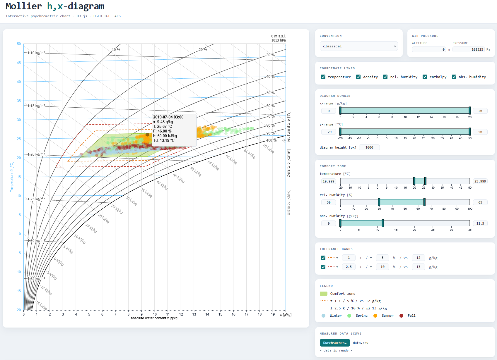

<p align="center">
  
</p>

<p align="center">
  <a href="https://hslu-ige-laes.github.io/d3-mollierhx/"></a>
  <a href="https://d3js.org/"></a>
  
  <a href="LICENSE"></a>
</p>

<p align="center">Mollier h,x diagram (psychrometric chart) for the browser, built on D3.js: iso-lines, comfort zone, tolerance bands and season-coloured measurements.</p>

## Overview
The Mollier h,x-diagram was proposed by Richard Mollier in 1923 and allows to describe changes of state of humid air. In the present case it is used to show comfort states regarding temperature and humidity.



- It is valid for a certain air pressure. The quantities temperature, humidity (absolute and relative), enthalpy and density can be read off directly.
- The basic scale for the h,x-diagram is a temperature scale, which is applied vertically as y-axis.
- The auxiliary lines drawn horizontally from left to right are the "isotherms", i.e. lines with constant air temperature. While the isotherm at 0 °C runs parallel to the horizontal axis, the isotherms at higher temperatures will increasingly rise to the right, due to the heat content of the increasing water content.
- The x-axis represents the water content x resp. the absolute humidity of the air.
- The comfort zone helps to indicate whether measured temperature/humidity values are within a comfortable range or not.
- Measured values get integrated as scatter plot and are coloured according to the season (winter, spring, summer, fall).

<hr>

## Live demo
Try it in the browser: [hslu-ige-laes.github.io/d3-mollierhx](https://hslu-ige-laes.github.io/d3-mollierhx/) (the same page as `example/demo.html`).

<hr>

## Usage
The D3 functions are structured in a way that the diagram can easily get integrated in own applications. Therefore csv file upload, comfort zone and data plotter are separated.

### /example/mollierhx.js & demo.html
Exemplary straight forward implementation with a manual csv file uploader and a simple html-file.
> Note that the data plotter is integrated in mollierhx.js because it is use case dependant what should get displayed.

<hr>

## Options / API

### /src/mollierFunctions.js
Functions for the coordinate-transformations in the Mollier hx-diagram.
In order to understand the equations in the source refer to chapter 2.1 and 2.2 of <a href="http://berndglueck.de/dl/?dl=Stoffwerte+Stoffwerte.pdf" target="_blank">"Glück: Zustands- und Stoffwerte"</a>.

### /src/coordinateGenerator.js
The function "drawHXCoordinates()" draws the coordinate-lines of temperature,
density, enthalpy and relative humidity into an SVG-element.

### /src/drawComfort.js
drawComfort() creates the comfort-zone polygon.

### /src/csvReader.js
The example contains a csv file upload, but the data can get passed directly from e.g. a database.

The csv file should begin with a date/time column in the format of the
ISO 8601 norm (%Y-%m-%dT%H:%M:%S.%LZ, for example "2020-31-03T22:00:00.000Z"). The following columns shall only contain numerical values. The first line of the file is reserved for the headers (read as strings). 

```csv
timestamp,humidity,temperature
2020-31-03T22:00:00.000Z,49,22.8
2020-31-03T23:00:00.000Z,53,23.5
```

<hr>

## Reading the diagram
<!-- TODO: text follows -->

<hr>

## Related implementations
### R Shiny
See [https://hslu-ige-laes.github.io/lcm/docs/modules/roomTempHum](https://hslu-ige-laes.github.io/lcm/docs/modules/roomTempHum)

### Python (pyedautils)
A Python port of this diagram (bundling these D3 sources) is available in the
**pyedautils** package: [https://github.com/retomarek/pyedautils](https://github.com/retomarek/pyedautils)
(`pip install pyedautils`). It renders the diagram from a pandas DataFrame via
`pyedautils.plots.plot_mollier_hx`, and adds comfort-zone overlays, warning
bands, season-coloured scatter and altitude/pressure annotation.

<hr>

## Questions and feedback
- **Questions or ideas?** Ask in [Q&A](https://github.com/hslu-ige-laes/d3-mollierhx/discussions/categories/q-a).
- **Found a bug or want a feature?** Open an [issue](https://github.com/hslu-ige-laes/d3-mollierhx/issues/new/choose).

<hr>

## Repository images
`docs/logo.svg` is generated by `scripts/make_logo.py`. `docs/banner.png` (README header), `docs/social-preview.png` (GitHub social preview, 1280×640) and `docs/screenshot.png` (the demo diagram) are rendered from `scripts/banner.html`, `scripts/social-preview.html` and `example/demo.html` with headless Chromium:

```bash
python scripts/make_logo.py
uv run --with playwright python -m playwright install chromium   # once
uv run --with playwright python scripts/render_branding.py
```

The social preview has to be uploaded manually under *Settings → General → Social preview* (there is no API for it).

<hr>

## License
MIT © Reto Marek, see [LICENSE](LICENSE).
