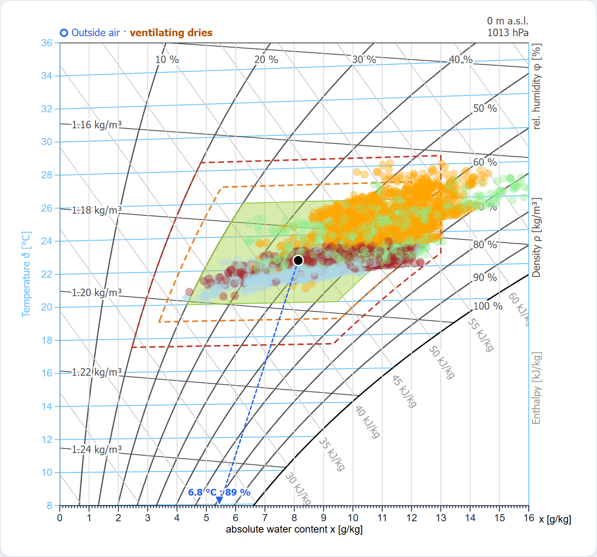

<p align="center">
  
</p>

<p align="center"><b><a href="https://hslu-ige-laes.github.io/d3-mollierhx/">Live demo and examples: hslu-ige-laes.github.io/d3-mollierhx</a></b></p>

<p align="center">
  <a href="https://hslu-ige-laes.github.io/d3-mollierhx/"></a>
  <a href="https://d3js.org/"></a>
  
  <a href="https://github.com/hslu-ige-laes/d3-mollierhx/discussions/categories/q-a"></a>
  <a href="LICENSE"></a>
</p>

<p align="center">Mollier h,x diagram (psychrometric chart) for the browser, built on D3.js: iso-lines, comfort zone, tolerance bands and season-coloured measurements.</p>

<p align="center">
  
</p>

> **Used in [pyedautils](https://github.com/retomarek/pyedautils)**, the *Python Energy Data Analysis Utilities*: `plot_mollier_hx()` and `plot_mollier_hx_fast()` bundle these sources, so you can draw the same diagram from pandas DataFrames in Python or Jupyter (`pip install pyedautils`).

> **In Home Assistant: [Mollier hx Card](https://github.com/retomarek/mollier-hx-card) and [Comfort Compass Card](https://github.com/retomarek/comfort-compass-card).** The same diagram as a dashboard card, with outside air and ventilation line, and the comfort compass with the same comfort zone and warning bands.

## Why the h,x diagram

The Mollier h,x-diagram was proposed by Richard Mollier in 1923 and allows to describe changes of state of humid air. In the present case it is used to show comfort states regarding temperature and humidity.

- It is valid for a certain air pressure. The quantities temperature, humidity (absolute and relative), enthalpy and density can be read off directly.
- The basic scale for the h,x-diagram is a temperature scale, which is applied vertically as y-axis.
- The auxiliary lines drawn horizontally from left to right are the "isotherms", i.e. lines with constant air temperature. While the isotherm at 0 °C runs parallel to the horizontal axis, the isotherms at higher temperatures will increasingly rise to the right, due to the heat content of the increasing water content.
- The x-axis represents the water content x resp. the absolute humidity of the air.
- The comfort zone helps to indicate whether measured temperature/humidity values are within a comfortable range or not.
- Measured values get integrated as scatter plot and are coloured according to the season (winter, spring, summer, fall).

## Features

- **Complete h,x diagram** for any air pressure: iso-lines of temperature, relative and absolute humidity, density and enthalpy, each family on or off, in the `classical` (per kg dry air) or `glueck` (per kg moist air) convention.
- **Psychrometric chart (ASHRAE) and IP units**: the same diagram transposed (dry-bulb temperature horizontal, humidity ratio on the right) and/or labelled in °F, gr/lb, Btu/lb and lb/ft³.
- **Comfort zone** as a polygon from temperature, relative and absolute humidity limits, plus orange and red **warning bands** around it.
- **Measurements** as a scatter plot coloured by season, with tooltips (x, T, φ, h, Td).
- **Outside air and ventilation**: the outside point, a dashed ventilation line to the room point and a note whether airing dries the room or adds moisture.
- **Edge arrows** with their value for room and outside points outside the axes.
- **Fast, incremental updates** with `MollierChart`: the grid is drawn once, data, zone, bands, frequency lines and process chains update in place; several charts can share a page.
- **Any language**: every caption and text is an option with English defaults; the captions fit from 420 px up.
- **Plain JavaScript**: global functions, no build step, strict-mode safe; the only dependency is D3.js v7.

## Live demo

**[hslu-ige-laes.github.io/d3-mollierhx](https://hslu-ige-laes.github.io/d3-mollierhx/)** –
[interactive demo](https://hslu-ige-laes.github.io/d3-mollierhx/example/demo.html) with example data
(Zürich-Kloten, hourly), comfort zone, warning bands, outside air and ventilation line, and the
[MollierChart test page](https://hslu-ige-laes.github.io/d3-mollierhx/example/chart-test.html).

## Requirements

[D3.js v7](https://d3js.org), e.g.
`<script src="https://cdn.jsdelivr.net/npm/d3@7.9.0/dist/d3.min.js"></script>`.

## Installation

The files in `/src` are plain browser scripts (global functions, no build step) that also run in
strict mode, so they can be inlined, concatenated or wrapped as ES modules. Load order:
`mollierFunctions.js`, `hxUnits.js`, `coordinateGenerator.js`, `drawComfort.js`, then `mollierChart.js`
(`hxUnits.js` is new in 0.3.0 and needed by the three after it).

## Usage

The D3 functions are structured in a way that the diagram can easily get integrated in own applications. Therefore csv file upload, comfort zone and data plotter are separated.

### /example/mollierhx.js & demo.html

Exemplary straight forward implementation with a manual csv file uploader and a simple html-file.
> Note that the data plotter is integrated in mollierhx.js because it is use case dependant what should get displayed.

## Options / API

### /src/mollierFunctions.js

Functions for the coordinate-transformations in the Mollier hx-diagram.
In order to understand the equations in the source refer to chapter 2.1 and 2.2 of <a href="http://berndglueck.de/dl/?dl=Stoffwerte+Stoffwerte.pdf" target="_blank">"Glück: Zustands- und Stoffwerte"</a>.

### /src/hxUnits.js

Units (SI ↔ IP) and the screen projection of the diagram. The diagram data always stay SI
(x in kg/kg, diagram-y in °C, h in kJ/kg, p in Pa); IP units only change ticks, labels and captions.

| name | purpose |
| --- | --- |
| `HX_UNITS` | constants and conversions: `cToF`, `fToC`, `kToF` / `fToK` (differences, ×1.8), `kgkgToGrlb` / `grlbToKgkg` (×7000), `mToFt` / `ftToM`, `paToInhg` / `inhgToPa` (3386.389 Pa per inHg), `kjkgToBtulb` / `btulbToKjkg` (absolute enthalpy, h_IP = h_SI / 2.326 + 7.686), `kjkgToBtulbDelta` / `btulbToKjkgDelta` (differences, /2.326), `kgm3ToLbft3` / `lbft3ToKgm3` (×0.0624279606) |
| `hxProjection(width, height, domainX, domainY, orientation)` | `{orientation, xScale, yScale, project(x, y) → [px, py], invert(px, py) → [x, y], line}`; `'mollier'` (default): px from x, py from y; `'psychrometric'`: px from y (left → right), py from x (bottom → top); `line` is a `d3.line` over `{x, y}` points |
| `hxNiceTicks(lo, hi, opts)` | round ticks in display units: `{step, major, minor}`; `opts.steps` (candidates), `maxCount`, `length` + `minSpacing` (px) |
| `hxIsIP(units)`, `hxOrientation(orientation)` | normalise the option values |

The enthalpy references differ: SI h = 0 for dry air at 0 °C, ASHRAE IP h = 0 for dry air at 0 °F,
so 0 kJ/kg ≈ 7.69 Btu/lb (`kjkgToBtulb`). For enthalpy *differences* use `kjkgToBtulbDelta`
(the same as `pyedautils.units.kjkg_to_btulb`).

### /src/coordinateGenerator.js

The function "drawHXCoordinates()" draws the coordinate-lines of temperature,
density, enthalpy and relative humidity into an SVG-element.

```js
drawHXCoordinates(container, Width, Height, margin, domainX, domainY, p, mollier, opts)
```

`opts` (all optional):

| key | default | meaning |
| --- | --- | --- |
| `showTemperature`, `showDensity`, `showRelHumidity`, `showEnthalpy`, `showAbsHumidity` | `true` | curve families on/off (lines, labels and caption) |
| `xAxisTitle` | `""` | title of the humidity axis (below it; rotated on the right in the psychrometric orientation) |
| `captions` | see below | caption texts; `""` hides a caption |
| `orientation` | `"mollier"` | `"psychrometric"`: ASHRAE layout, see [below](#psychrometric-chart-ashrae-and-ip-units) |
| `units` | `"si"` | `"ip"`: °F, gr/lb, Btu/lb, lb/ft³ for ticks, labels and captions (domains stay SI) |

`captions` keys and English defaults (`HX_DEFAULT_CAPTIONS`, for `units: "si"`):

| key | default | where |
| --- | --- | --- |
| `temperature` | `Temperature ϑ [°C]` | left axis, rotated |
| `rel_humidity` | `rel. humidity φ [%]` | right edge, top |
| `density` | `Density ρ [kg/m³]` | right edge, middle |
| `enthalpy` | `Enthalpy [kJ/kg]` | right edge, bottom |
| `x_axis` | `x [g/kg]` | right margin, beside the end of the x axis |
| `x_axis_title` | `""` (or `xAxisTitle`) | below the x axis |

With `units: "ip"` the defaults are `HX_DEFAULT_CAPTIONS_IP`: `Dry-bulb temperature [°F]`,
`Relative humidity [%]`, `Density [lb/ft³]`, `Enthalpy [Btu/lb]`, `W [gr/lb]` and `""`. In the
psychrometric orientation `x_axis` defaults to `Humidity ratio x [g/kg]` / `Humidity ratio W [gr/lb]`
(there is room for it along the right axis). `hxDefaultCaptions(units, orientation)` returns the
defaults; `hxResolveCaptions(opts)` merges `opts.captions` over them, so the keys keep their meaning
in every layout.

The right-edge captions are laid out from the top of the axis down, one equal segment each, with a
common font size of 8–12 px that follows from text length and chart height, so they fit at 420 px
as well as at 700 px or more (very long translations are shortened with "…"). Every caption has the
CSS class `hx-caption` plus `hx-caption-temperature`, `hx-caption-rel-humidity`,
`hx-caption-density`, `hx-caption-enthalpy`, `hx-caption-x-axis` or `hx-caption-x-axis-title`.

```js
drawHXCoordinates(d3.select("#chart"), 600, 420, {top: 30, right: 60, bottom: 40, left: 50},
                  [0, 0.02], [-20, 50], 101325, createMollier(),
                  { captions: { temperature: "Temperatur ϑ [°C]", rel_humidity: "rel. Feuchte φ [%]",
                                density: "Dichte ρ [kg/m³]", enthalpy: "Enthalpie h [kJ/kg]" } });
```

### /src/drawComfort.js

drawComfort() creates the comfort-zone polygon (`createComfort()` returns its points). It takes an
optional last argument `opts = { orientation }`.

The file also holds overlay helpers (plain globals). They draw into a `<g>` in plot coordinates
(translated to the top-left corner of the axes) and take a context
`ctx = { x, y, width, height, mollier, pressure, project, units }` (the d3 scales, the size of the
axes in px, the `createMollier()` suite and the pressure in Pa; optional `project` from
`hxProjection(...)`, used instead of `x` / `y` and needed for the psychrometric orientation, and
`units` `"si"` | `"ip"` for the default edge-arrow label). A *state* is `{t, rh}` (rh in %), `{t, phi}`
(phi 0..1) or a diagram position `{x, y}`.

| function | purpose |
| --- | --- |
| `hxAddClipPath(svg, id, width, height)` | clip path for the data layers; returns `"url(#id)"` |
| `hxDrawStatePoint(layer, ctx, state, opts)` | point (`opts.color`, `opts.hollow`, `opts.r`, `opts.className`); outside the axes an arrow on the edge with its value |
| `hxDrawOutdoor(layer, ctx, outdoor, room, opts)` | outside air (hollow blue circle) + dashed ventilation line to the room point + note above the axes; returns `{outdoor, room, effect, note, marker}` |
| `hxVentilationEffect(room, outdoor, threshold)` | `"dries"` / `"humidifies"` / `"neutral"` / `null` (threshold 0.0003 kg/kg = 0.3 g/kg) |
| `hxVentilationNote(effect, texts)` | the sentence for an effect |
| `hxClampPoint(ctx, state)`, `hxDrawEdgeArrow(layer, ctx, pos, color, label)` | building blocks of the edge arrow |
| `hxState(state, mollier, p)`, `hxStateLabel(state, texts, units)` | normalise a state; edge label like `6.8 °C · 89 %` (`units` `"ip"`: `44.3 °F · 89 %`) |
| `hxPlaceContourLabels(items, opts)` | one label per frequency line without overlaps: inside the axes, at least `minGap` (4 px) apart, the highest free spot of the line, else the one farthest from the other labels; dropped when the line has no free spot |
| `hxDrawContourLabels(layer, contours, toScreen, opts)` | draws those labels (bold value on a white box); used by `MollierChart` and the demo |

`hxDrawOutdoor` options: `color` (`#2563eb`), `ventilationLine` (`true`), `note` (`true`),
`notePosition` (`[0, -8]`), `threshold` (`0.0003`), `texts`. Draw it (and the room point) into an
**unclipped** layer, the data, comfort zone and bands into the clipped one.

**Outside air and ventilation:** when you air a room, the room air moves along the straight line to
the outside point (mixing). If the outside point lies to the **left** (less water per kg of air, by
more than 0.3 g/kg) airing dries the room, even when the outside air has 90 % relative humidity; to
the right it adds moisture (typical for a cool cellar in summer); otherwise there is no noticeable
change.

All texts are options with English defaults (`HX_DEFAULT_TEXTS`), no translations are built in:

| key | default |
| --- | --- |
| `outdoor` | `Outside air` |
| `room` | `Room` |
| `ventilation_dries` | `ventilating dries` |
| `ventilation_humidifies` | `ventilating adds moisture` |
| `ventilation_neutral` | `ventilating: no change` |
| `state_value` | `{t} °C · {rh} %` (edge-arrow label; also `{x}` in g/kg, `{t_f}` in °F, `{x_gr}` in gr/lb; IP default `{t_f} °F · {rh} %`, `HX_DEFAULT_TEXTS_IP`) |

CSS classes: `hx-outdoor`, `hx-outdoor-point`, `hx-ventilation-line`, `hx-ventilation-note`
(+ `hx-ventilation-dries|humidifies|neutral`), `hx-edge-arrow`, `hx-edge-label`, `hx-state`.

```js
const ctx = { x, y, width, height, mollier, pressure: 101325 };
const clipped = svg.append("g").attr("transform", `translate(${margin.left},${margin.top})`)
                   .attr("clip-path", hxAddClipPath(svg, "plot-clip", width, height));
const top = svg.append("g").attr("transform", `translate(${margin.left},${margin.top})`);
const res = hxDrawOutdoor(top, ctx, { t: 4, rh: 85 }, { t: 21, rh: 50 },
                          { texts: { outdoor: "Aussenluft", ventilation_dries: "Lüften trocknet" } });
hxDrawStatePoint(top, ctx, { t: 21, rh: 50 });
console.log(res.effect);   // "dries"
```

### /src/mollierChart.js

`MollierChart` is a stateful chart for fast, incremental updates: the coordinate grid is drawn once,
the overlays update in place (used by `pyedautils.plots.plot_mollier_hx_fast`).

```js
const chart = new MollierChart("#chart", {
  height: 700, pressure: 101325, convention: "classical",
  domainX: [0, 0.02], domainY: [-20, 50],
  lineOpts: { showDensity: true, xAxisTitle: "absolute water content x [g/kg]" },
  captions: { temperature: "Temperatur ϑ [°C]" },   // as drawHXCoordinates opts.captions
  texts: { outdoor: "Aussenluft", now: "Jetzt" }     // any user-visible text, see below
});
chart.setData(records);                  // [{t, rh, time}, ...] (rh in %)
chart.setComfort({ t: [20, 26], phi: [0.3, 0.65], x: [0, 0.0115] });
chart.setBands(orange, red);             // each {t, phi, x, color} | null
chart.setCurrent({ t: 22.5, rh: 48 });   // room point, edge arrow when off-axis
chart.setOutdoor({ t: 6.8, rh: 89 });    // outside air + ventilation line and note
chart.ventilationEffect();               // "dries" | "humidifies" | "neutral" | null
chart.ventilationNote();                 // e.g. "ventilating dries"
chart.setTexts({ ventilation_dries: "Lüften trocknet" });
chart.setCaptions({ density: "" });      // hide a caption
```

`setOutdoor(state, opts)` options: `color`, `ventilationLine` (`true`), `note` (`true`), `threshold`
(`0.0003` kg/kg), `room` (instead of the point from `setCurrent`). `setCurrent(state, opts)`:
`color` (`black`). Other methods: `setFrequency`, `setProcessChain`, `setMeanLines`,
`setShowPoints`, `setCoordinateLines`, `setDomain`, `setPressure`, `setConvention`, `setHeight`,
`resize`, `onPlotClick`, `destroy`, and `setOrientation("mollier" | "psychrometric")` /
`setUnits("si" | "ip")` (constructor options `orientation` and `units`, defaults `"mollier"` and
`"si"`). All screen positions go through `chart.project(x, y)` (`chart.proj` is the
`hxProjection`); `chart.x` / `chart.y` are its scales. `onPlotClick` always reports SI values.
With `units: "ip"` tooltips show °F, gr/lb and Btu/lb, the default humidity-axis title is
`humidity ratio W [gr/lb]` (unless `lineOpts.xAxisTitle` is given) and the texts take the
IP defaults below.

Texts (`opts.texts` / `setTexts`), in addition to `HX_DEFAULT_TEXTS` above
(`MOLLIER_CHART_DEFAULT_TEXTS`):

| key | default |
| --- | --- |
| `now` | `Now` (tooltip title of the room point) |
| `tip_x`, `tip_t`, `tip_phi`, `tip_h`, `tip_td` | `x`, `T`, `φ`, `h`, `Td` (tooltip row labels) |
| `freq_hours`, `freq_days` | `{n} h/year outside`, `{n} days/year outside` |
| `altitude`, `pressure` | `{alt} m a.s.l.`, `{hpa} hPa` (top right; `""` hides); IP defaults (`MOLLIER_CHART_DEFAULT_TEXTS_IP`) `{alt_ft} ft`, `{inhg} inHg`; placeholders `{alt}` (m), `{alt_ft}`, `{hpa}`, `{inhg}`, `{pa}` |

The placeholders keep their units in every mode (`{t}` is always °C, `{alt}` always m), so
translated templates stay correct; IP values have their own placeholders.

Data, comfort zone, bands and frequency lines are clipped to the axes; room and outside points sit in
an unclipped layer on top (`g.hx-top > g.hx-points`). Ids (clip path, arrow marker) are unique per
chart, so several charts can share a page.

### Psychrometric chart (ASHRAE) and IP units

In the US the same physics is drawn as the ASHRAE psychrometric chart: dry-bulb temperature
horizontal (°F), humidity ratio vertical with its scale on the right (gr/lb = g/kg × 7), the
saturation curve top left, the enthalpy scale on the diagonal beyond the saturation curve (Btu/lb).
The classical h,x diagram with its axes swapped is exactly this construction, so the library only
changes the projection:

```js
drawHXCoordinates(d3.select("#chart"), 900, 600, {top: 30, right: 60, bottom: 45, left: 50},
                  [0, 0.02], [-20, 50], 101325, createMollier(),
                  { orientation: "psychrometric", units: "ip" });

const chart = new MollierChart("#chart", { orientation: "psychrometric", units: "ip" });
chart.setUnits("si");                     // orientation and units are independent
```

- `orientation` and `units` are independent: `mollier` + `ip` is the h,x diagram with °F / gr/lb
  labels, `psychrometric` + `si` the ASHRAE layout in °C / g/kg.
- Domains, data, states and callbacks stay SI (`domainX` in kg/kg, `domainY` in °C); IP ticks are
  round IP values (°F every 10, gr/lb every 10 or 20, Btu/lb every 5, lb/ft³ every 0.005, depending
  on the size) converted to SI for drawing; the iso-temperature and iso-humidity lines sit on these
  ticks.
- Psychrometric layout: temperature axis at the bottom, humidity-ratio axis on the right (the
  rotated caption there is `x_axis_title` if set, else `x_axis`), the family captions (relative
  humidity, density, enthalpy) along the left edge. Keep `margin.right` ≥ 50 px for the tick
  numbers and the caption.
- Overlays: pass `ctx.project` (and `ctx.units`) to the helpers of `drawComfort.js`; `MollierChart`
  does this itself.

### /src/csvReader.js

The example contains a csv file upload, but the data can get passed directly from e.g. a database.

The csv file should begin with a date/time column in the format of the
ISO 8601 norm (%Y-%m-%dT%H:%M:%S.%LZ, for example "2020-31-03T22:00:00.000Z"). The following columns shall only contain numerical values. The first line of the file is reserved for the headers (read as strings). 

```csv
timestamp,humidity,temperature
2020-31-03T22:00:00.000Z,49,22.8
2020-31-03T23:00:00.000Z,53,23.5
```

### Checks

`node test/check.js` runs dependency-free checks of the pure helpers (caption layout, ventilation
effect, state handling, unit conversions, projection, IP ticks) with the sources evaluated in
strict mode.

## Changelog

See [CHANGELOG.md](CHANGELOG.md).

## Reading the diagram, comfort and saving energy

New to the h,x diagram? The pyedautils guide
[The h,x diagram in five minutes](https://retomarek.github.io/pyedautils/guides/mollier_hx.html)
explains it step by step, with worked examples:

- [Reading the diagram correctly](https://retomarek.github.io/pyedautils/guides/mollier_hx.html#hx-reading-the-diagram):
  relative humidity vs. water content, why heating and cooling move the point vertically, the effect of altitude, and
  [dew point and mould at cold surfaces](https://retomarek.github.io/pyedautils/guides/mollier_hx.html#hx-dew-point).
- [Comfort](https://retomarek.github.io/pyedautils/guides/mollier_hx.html#hx-comfort): what the comfort zone and the warning bands mean, and why temperature and humidity belong together.
- [Saving energy](https://retomarek.github.io/pyedautils/guides/mollier_hx.html#hx-saving-energy): heating less, short and intensive airing in winter, not over-humidifying, airing cellars and night cooling in summer.

Background: [Mollier diagram](https://en.wikipedia.org/wiki/Psychrometrics#Mollier_diagram) on Wikipedia.

## Related projects

- [pyedautils](https://github.com/retomarek/pyedautils): Python Energy Data Analysis Utilities, with the h,x diagram (`plot_mollier_hx`), the comfort compass (`plot_comfort_compass`) and [guides on reading them](https://retomarek.github.io/pyedautils/guides/) (`pip install pyedautils`).
- [EDAP: Energy Data Analysis with Python](https://github.com/retomarek/edap): an interactive online book on analysing and visualising energy and comfort time series with pandas, Plotly and pyedautils ([read the book](https://retomarek.github.io/edap/intro.html)).
- [Mollier hx Card](https://github.com/retomarek/mollier-hx-card): the h,x diagram as a Home Assistant dashboard card, with outside air and ventilation line.
- [Comfort Compass Card](https://github.com/retomarek/comfort-compass-card): the comfort compass as a Home Assistant dashboard card: how many days were too warm, too humid, too dry or too cold.
- [R Shiny implementation](https://hslu-ige-laes.github.io/lcm/docs/modules/roomTempHum) (module roomTempHum).

## Questions and feedback

- **Questions or ideas?** Ask in [Q&A](https://github.com/hslu-ige-laes/d3-mollierhx/discussions/categories/q-a).
- **Found a bug or want a feature?** Open an [issue](https://github.com/hslu-ige-laes/d3-mollierhx/issues/new/choose).
- **Find it useful?** A star on GitHub helps others find it.

## Repository images

`docs/logo.svg` is generated by `scripts/make_logo.py`. `docs/banner.png` (README header), `docs/social-preview.png` (GitHub social preview, 1280×640) and `docs/screenshot.png` (the demo diagram) are rendered from `scripts/banner.html`, `scripts/social-preview.html` and `example/demo.html` with headless Chromium:

```bash
python scripts/make_logo.py
uv run --with playwright python -m playwright install chromium   # once
uv run --with playwright python scripts/render_branding.py
```

The social preview has to be uploaded manually under *Settings → General → Social preview* (there is no API for it).

## License

MIT © Reto Marek, see [LICENSE](LICENSE).
